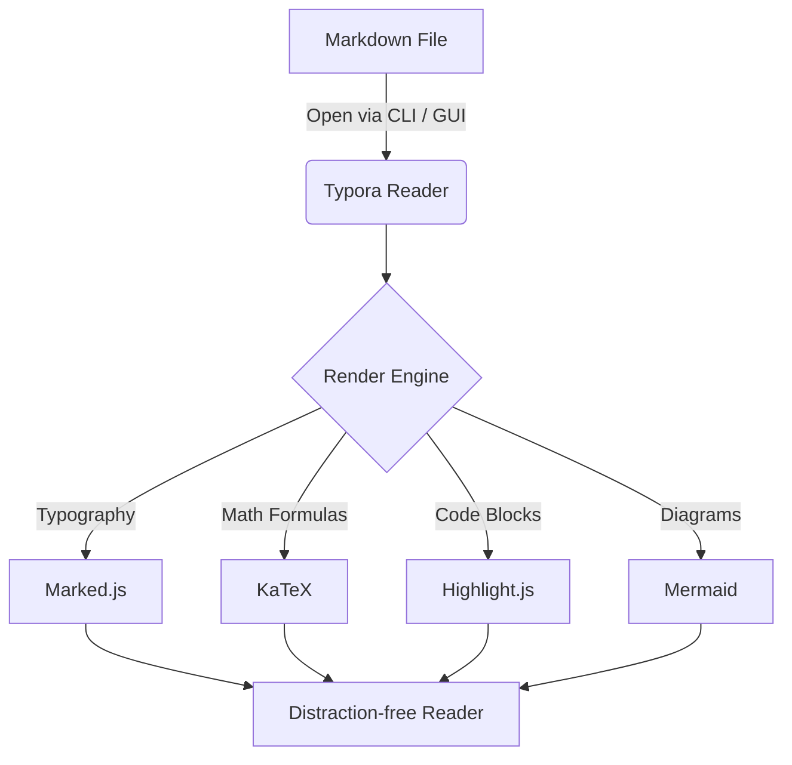

# Typora Reader Showcase

Welcome to **Typora Reader**, a minimalist, distraction-free Markdown viewer engineered to deliver the iconic Typora reading experience on both **macOS** and **Omarchy Arch Linux**.

---

## 1. Typography & Formatting

Good typography is the essence of Typora. Markdown elements should feel clean, organic, and effortless to read.

### 1.1 Text Styles
- **Bold text** with `**bold**` or `__bold__`
- *Italicized text* with `*italic*` or `_italic_`
- ***Bold and italic*** with `***bold italic***`
- ~~Strikethrough~~ with `~~strikethrough~~`
- Inline code like `const answer = 42;` with backticks
- Text highlighting like ==marked text== using `==highlight==`
- Keyboard shortcuts: <kbd>Ctrl</kbd> + <kbd>O</kbd> to open, <kbd>Ctrl</kbd> + <kbd>Shift</kbd> + <kbd>O</kbd> to toggle the outline sidebar.

### 1.2 Blockquotes
> "Simplicity is prerequisite for reliability."  
> — *Edsger W. Dijkstra*

Nested quotes are also supported seamlessly:

> Design is not just what it looks like and feels like.
>> Design is how it works.
>> — *Steve Jobs*

---

## 2. Lists & Task Management

### 2.1 Task Lists
Interactive checkboxes can be checked or unchecked:
- [x] Create lightweight, zero-dependency Markdown reader
- [x] Support seamless offline rendering with KaTeX and Highlight.js
- [x] Integrate with Omarchy Arch Linux desktop & Hyprland
- [x] Live-reload on file edits from Neovim, Helix, or VS Code
- [ ] Add PDF export enhancements
- [ ] Add custom user CSS styling themes

### 2.2 Ordered and Unordered Lists
1. **Architecture**
   1. Fast parsing with `marked.js`
   2. Offline syntax highlighting with `highlight.js`
   3. Mathematical typeset via `KaTeX`
2. **Portability**
   - Single portable HTML reader
   - Standalone Python 3 CLI runner (`typora-reader.py`)
   - Desktop entry for Hyprland / Rofi / Wofi

---

## 3. Mathematical Typesetting (KaTeX)

Typora Reader includes full KaTeX mathematical equation rendering.

### 3.1 Inline Formulas
The famous mass-energy equivalence $E = mc^2$, or Euler's identity $e^{i\pi} + 1 = 0$, render cleanly inside paragraphs.

### 3.2 Display Equations
Gaussian distribution probability density function:

$$f(x \mid \mu, \sigma^2) = \frac{1}{\sqrt{2\pi \sigma^2}} e^{-\frac{(x - \mu)^2}{2\sigma^2}}$$

Maxwell's equations in differential form:

$$\begin{aligned}
\nabla \cdot \mathbf{E} &= \frac{\rho}{\varepsilon_0} \\
\nabla \cdot \mathbf{B} &= 0 \\
\nabla \times \mathbf{E} &= -\frac{\partial \mathbf{B}}{\partial t} \\
\nabla \times \mathbf{B} &= \mu_0 \mathbf{J} + \mu_0 \varepsilon_0 \frac{\partial \mathbf{E}}{\partial t}
\end{aligned}$$

---

## 4. Code Blocks with Syntax Highlighting

Hover over any code block to reveal the **Copy** button.

### 4.1 Python Example
```python
import sys
from pathlib import Path

def inspect_markdown(filepath: str) -> dict:
    """Analyze a markdown file and count basic statistics."""
    path = Path(filepath)
    if not path.is_file():
        raise FileNotFoundError(f"File not found: {path}")

    content = path.read_text(encoding="utf-8")
    words = len(content.split())
    lines = content.count("\n") + 1
    
    return {
        "filename": path.name,
        "word_count": words,
        "line_count": lines,
        "reading_time_mins": max(1, round(words / 200))
    }

if __name__ == "__main__":
    stats = inspect_markdown("sample.md")
    print(f"Reading stats: {stats}")
```

### 4.2 Rust Example
```rust
use std::fs;
use std::path::Path;

fn main() -> Result<(), Box<dyn std::error::Error>> {
    let path = Path::new("sample.md");
    let content = fs::read_to_string(path)?;
    
    println!("Successfully loaded {} bytes from {:?}", content.len(), path);
    Ok(())
}
```

### 4.3 Shell / Hyprland Command
```bash
# Launch any markdown document directly on Omarchy Arch
typora-reader ~/Notes/architecture.md
```

---

## 5. Rich Tables

Tables feature clean borders and alternating row stripes matching Typora themes:

| Feature | Typora Native | Typora Reader | Omarchy Arch Support |
| :--- | :---: | :---: | :---: |
| **Distraction-free View** | Yes | Yes | Native Browser / App Mode |
| **Table of Contents Outline**| Yes | Yes | Yes |
| **Live Reload on Edit** | Yes | Yes | Yes (watches mtime) |
| **KaTeX Math Rendering** | Yes | Yes | 100% Offline |
| **Syntax Highlighting** | Yes | Yes | Multi-language auto-detect |
| **Zero Dependencies** | No | Yes | Python 3 standard library |

---

## 6. Diagrams (Mermaid)

Typora Reader renders Mermaid diagrams directly into responsive vector SVGs:



---

## 7. Keyboard Shortcuts

Typora Reader features familiar keyboard shortcuts:

| Shortcut | Action |
| :--- | :--- |
| <kbd>Ctrl</kbd> / <kbd>Cmd</kbd> + <kbd>O</kbd> | Open local Markdown file |
| <kbd>Ctrl</kbd> / <kbd>Cmd</kbd> + <kbd>Shift</kbd> + <kbd>O</kbd> | Toggle Table of Contents sidebar |
| <kbd>Ctrl</kbd> / <kbd>Cmd</kbd> + <kbd>F</kbd> | Find text in document with Prev/Next navigation |
| <kbd>Ctrl</kbd> / <kbd>Cmd</kbd> + <kbd>P</kbd> | Print or Export clean PDF |
| <kbd>Esc</kbd> | Dismiss search or dialog |

---

*Enjoy distraction-free reading with Typora Reader!*
